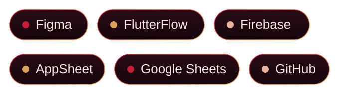
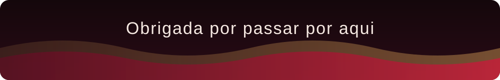

 

Transformo problemas reais em produtos organizados e fáceis de usar. Acompanho a ideia do início ao fim: entendo o problema, escrevo os requisitos, desenho as telas e construo o aplicativo.

Campo Grande, MS.

## Como eu trabalho

**Design de interfaces e experiência do usuário.** Da prototipação ao visual final, com foco em telas claras e fluxos simples.

**Documentação de produto.** Requisitos funcionais e não funcionais, regras de negócio, personas e fluxos de usuário.

**Desenvolvimento web e mobile.** Experiência com HTML e CSS, noções de Python e Java, e construção de aplicativos com ferramentas low-code e backend na nuvem. Agora aprofundando meus estudos em FlutterFlow.

**Trabalho em equipe.** Gosto de construir em grupo e de apresentar os projetos que desenvolvo.

## Linguagens e ferramentas

## Projetos

 

